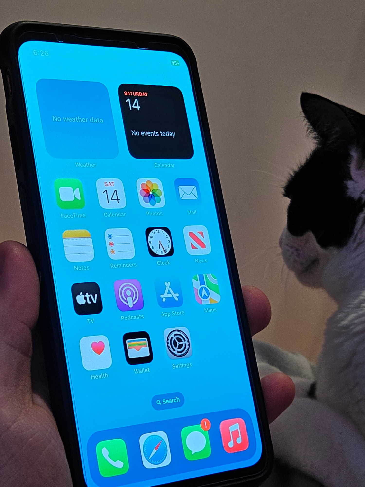

# iOS on the RedMagic 7 (NX679J)

Apple's open-source XNU kernel and an iOS 16 userland running natively on the
nubia RedMagic 7 (NX679J, Snapdragon 8 Gen 1 / SM8450 "waipio"). The phone boots
from a small shim in `boot_a`, the kernel and device tree are built here, and the
iOS root lives in a pinned file on the Android data partition.

This repository holds **source only**: the kernel changes as a patch against
Apple's `xnu-8796.141.3`, the boot shim, the payload and device-tree tools, the
Wi-Fi driver glue and the GPU/userland helpers. No iOS, IPSW, Apple binaries or
phone firmware are included (see [Legal](#legal)).

## Status (initial import)

| Part | State |
|---|---|
| Boot to lock screen and home screen, stock apps | yes (some apps still do not draw) |
| Touch, power and volume keys, display brightness | yes |
| GPU (Adreno 730) rendering for CoreAnimation | yes, via the HakiosMetal plug-in |
| Battery level and charger, RTC and time zone | yes |
| Settings (incl. General > About, Date & Time) | yes |
| **Wi-Fi** (QCA6490 / WCN6855 over PCIe + MHI, ath11k) | **yes**: scans, joins WPA2, ~118 Mb/s measured |
| Wi-Fi signal bars | wrong (fix in progress) |
| Bluetooth | no (scoped: QCA6490 over GENI UART) |
| Cellular | no (scoped: MPSS PAS, QRTR/QMI, IPA) |
| Some apps (Notes, Maps, Wallet, ...) | do not render yet |

The Wi-Fi bring-up path, for the record: QCA6490 power-up (RPMh rails, AOP
iPA vote, the eGPIO-backed XO clock pin) → PCIe Gen2 link → MHI/BHI(e)
firmware load → QRTR/QMI WLFW → Linux ath11k (WCN6855 hw2.0) under a LinuxKPI
layer → `en0` plus `IO80211Controller`/`IONetworkStack` nubs so `wifid` and
`configd` accept it. It uses the **linux-firmware** `ath11k/WCN6855/hw2.0`
firmware (not the phone's Android firmware, which faults right after association
under ath11k) and Qualcomm's reference board file from `board-2.bin`.

## Layout

| Path | What |
|---|---|
| `kernel/redmagic7-xnu-8796.141.3.patch` | All kernel changes against Apple's `xnu-8796.141.3` tag: the mondrian (SM8450) platform port, RedMagic drivers (display, touch, GPU, battery, RTC, UFS), and the Wi-Fi stack in `bsd/dev/rmwifi/` |
| `kernel/build.sh` | Build driver (from blacktop's darwin-xnu-build, MIT; `kernel/LICENSE.darwin-xnu-build`) with `RM_OBJECTS=` support for the ath11k object |
| `redmagic7/shim/` | The Android-boot-image shim that loads the XNU payload |
| `redmagic7/tools/` | `mkpayload.py` (kernel + ADT payload, `/chosen` options), ADT tools, root-image and disk-extent helpers, log ring watcher |
| `redmagic7/wifi/` | `build-ath11k.sh` (builds the ath11k object from HackiOS's LinuxKPI tree + overlays), our overlays (`overlay/wifi/lx/src/`), PCIe PHY sequence generator |
| `redmagic7/gpu/` | CoreAnimation/Metal plug-in sources, the `ca-watch` diagnostics dylib, the hakios-metal sources |
| `redmagic7/cellular/` | Cellular scope notes |

## Building (outline)

1. Check out Apple's `xnu-8796.141.3` and apply `kernel/redmagic7-xnu-8796.141.3.patch`.
2. Supply the files this repository does not carry, from your own sources:
   - `bsd/dev/mondrian_{gmu,sqe,zap}_fw.h` and `bsd/dev/mondrian_cp_profile.h` (Adreno firmware and register profile, generated by the ios-mondrian tools from your phone's firmware);
   - `bsd/dev/rm_blob.h` (optional: files the kernel carries, generated by `redmagic7/gpu/gen-blob.py`; Wi-Fi firmware is carried as `fw:amss20.bin`, `fw:m3.bin`, `fw:bdwlang.elf`, `fw:regdb.bin`);
   - `bsd/dev/redmagic_extents.h` comes from `redmagic7/tools/gen-extents-h.py` for your own root-image file.
3. Build the ath11k object (`redmagic7/wifi/build-ath11k.sh`), then the kernel with `kernel/build.sh` (`KERNEL_CONFIG=DEVELOPMENT MACHINE_CONFIG=MONDRIAN`, `RM_OBJECTS=<ath11k.o>`).
4. Make the payload with `redmagic7/tools/mkpayload.py` (kernel + an ADT you generate from your own IPSW), wrap it with `redmagic7/shim/build-redmagic.sh`, flash to `boot_a`.

Device-specific values (adb serial, Wi-Fi MAC) are passed by environment
variables / `mkpayload.py --chosen-str`, never stored here.

## Legal

The kernel changes modify Apple's XNU and are under the Apple Public Source
License 2.0, like the files they change. Files taken from other projects keep
their licenses and headers: the Linux ath11k driver (BSD-3-Clause-Clear / ISC),
FreeBSD's LinuxKPI (BSD), HackiOS (APSL 2.0 for its XNU parts), ios-mondrian,
iOSPlus10 (MIT). iOS, its images, Apple's binaries and trademarks, and the
phone's and Qualcomm's firmware are **not** in this repository; you take them
from your own device and your own IPSW. "iOS", "iPhone" and "Apple" are named
only to describe what the code works with.

## Credits

- [ios-mondrian](https://github.com/xNekom/ios-mondrian) (from ios-sweet): the XNU platform port this tree grew from.
- [HackiOS, Xiaomi Mi 10 port](https://github.com/JopangJovan/hackios-xnu-kernel-umi): the Wi-Fi stack (QCA6390 PCIe/MHI, LinuxKPI + ath11k, apple80211 glue) this port adapts to the QCA6490.
- [iOSPlus10](https://github.com/akshaynexus/iOSPlus10) (OnePlus 10 Pro, the same SM8450): the QCA6490 power-up hint (eGPIO XO clock) and SM8450 references.
- Linux ath11k and linux-firmware.
